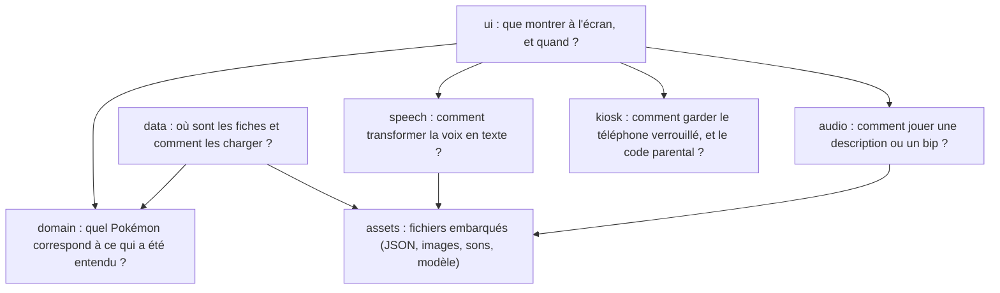
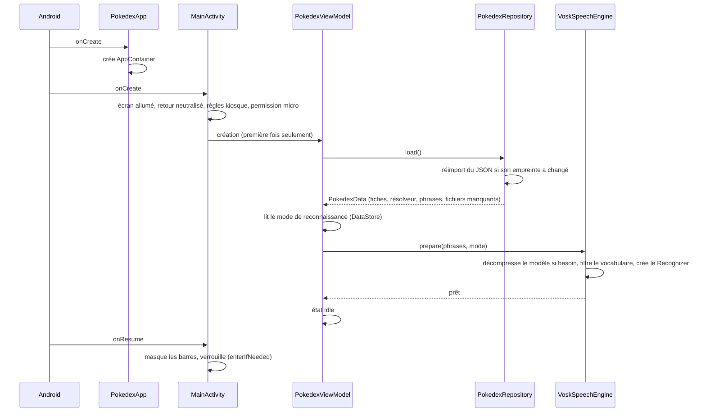
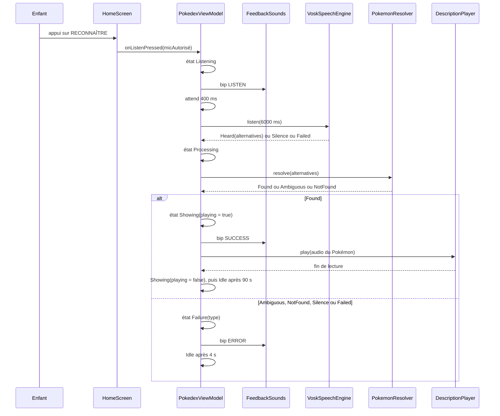
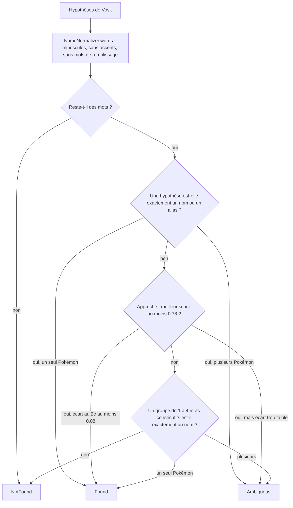
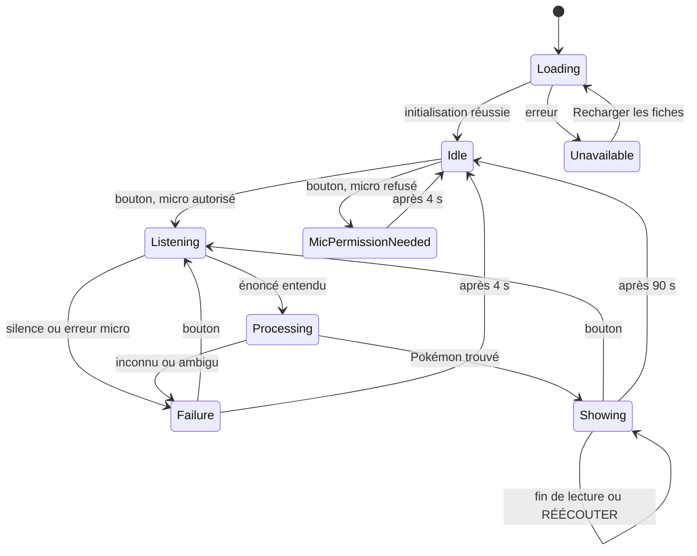
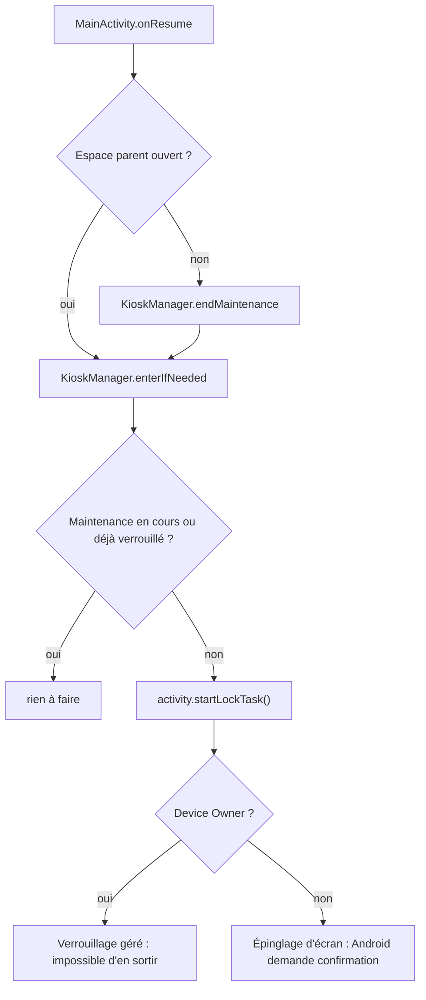
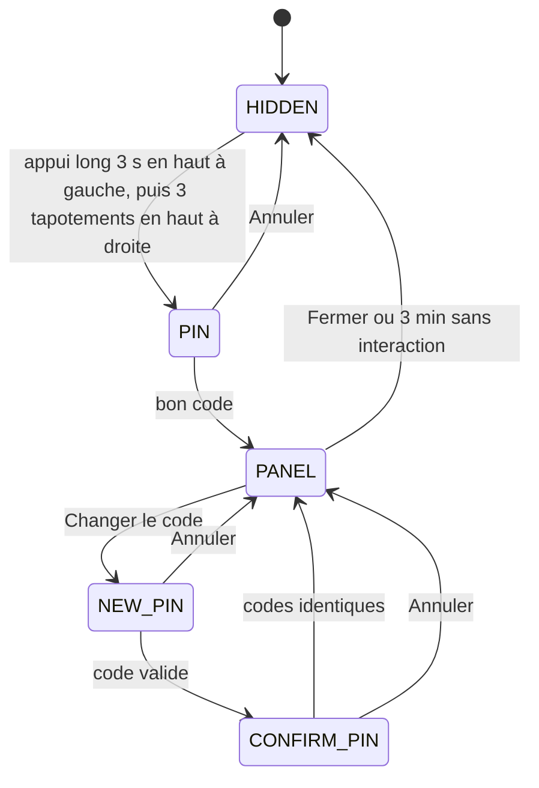

# Architecture du Pokédex

Ce document explique comment l'application est construite, à quoi sert chaque dossier et chaque
fichier, et comment y apporter des corrections sans être un spécialiste d'Android. Il complète le
[README](README.md), qui couvre la compilation, l'installation et les tests sur émulateur ou
téléphone.

Lecture conseillée :

- pour comprendre le projet : sections 1 à 4, dans l'ordre ;
- pour faire une modification précise : section 5 (« Recettes pas à pas »), qui renvoie aux bons
  fichiers ;
- quand quelque chose ne marche pas : section 6 (« Corriger un bug »).

Sommaire :

1. [Vue d'ensemble](#1-vue-densemble)
2. [Notions Android minimales](#2-notions-android-minimales)
3. [Arborescence commentée](#3-arborescence-commentée)
4. [Flux principaux](#4-flux-principaux)
5. [Recettes pas à pas](#5-recettes-pas-à-pas)
6. [Corriger un bug : méthode et outils](#6-corriger-un-bug--méthode-et-outils)
7. [Glossaire](#7-glossaire)

---

## 1. Vue d'ensemble

### Ce que fait l'application

L'enfant appuie sur un grand bouton. L'application ouvre le micro quelques secondes, transforme ce
qu'elle entend en texte grâce à un moteur de reconnaissance vocale embarqué (Vosk), cherche à quel
Pokémon ce texte correspond, puis affiche sa fiche (image, nom, numéro) et lit sa description
enregistrée. Un bouton permet de réécouter. Sur le téléphone dédié, l'application est verrouillée
au premier plan (mode kiosque) et un espace parent caché permet la maintenance.

### Les principes qui guident le code

- **Tout est local.** Les fiches, les images, les sons et le modèle de reconnaissance sont dans
  l'application. Le manifeste retire explicitement la permission `INTERNET` : même une
  bibliothèque ne pourrait rien envoyer.
- **Jamais de fiche au hasard.** Si le texte entendu peut correspondre à deux Pokémon, ou à aucun,
  l'application affiche un message d'échec plutôt que de deviner.
- **Le micro n'est ouvert que pendant une écoute.** Il est fermé dès la fin de l'énoncé, à
  l'expiration du délai, ou dès que l'application est interrompue.
- **Les données se complètent sans toucher au code.** Ajouter un alias, une image ou une
  description consiste à modifier un fichier JSON ou à déposer un fichier.
- **Chaque partie est testable seule.** La logique (reconnaissance du nom, machine à états) ne
  dépend pas directement d'Android, ce qui permet de la tester sur l'ordinateur sans téléphone.

### Les couches

Le code Kotlin est rangé en paquets (dossiers) qui répondent chacun à une question :



Une flèche signifie « utilise ». L'interface (`ui`) orchestre tout : c'est elle qui décide qu'il
faut écouter, puis interroge `domain` pour trouver le Pokémon, puis demande à `audio` de lire la
description. `domain` ne connaît ni l'écran ni le micro : il travaille uniquement sur du texte.

Un objet central, `AppContainer` (dans [`PokedexApp.kt`](app/src/main/java/fr/jo/pokedex/PokedexApp.kt)),
crée une seule fois chaque service (base de données, moteur vocal, lecteur audio…) et les fournit à
ceux qui en ont besoin.

---

## 2. Notions Android minimales

Cette section explique les termes indispensables, chacun illustré par le fichier du projet qui
l'utilise. Il n'est pas nécessaire de tout retenir : revenez-y quand un mot vous bloque.

### Construire l'application

**APK.** Le fichier installable sur un téléphone (comme un `.exe` sous Windows). Il contient le
code compilé, les ressources et les fichiers embarqués. Le projet produit
`app/build/outputs/apk/debug/app-debug.apk` (pour les essais) et
`app/build/outputs/apk/release/app-release.apk` (optimisé, pour le téléphone dédié).

**Gradle.** L'outil qui compile le projet, télécharge les bibliothèques et produit l'APK. On ne
l'installe pas soi-même : le script `./gradlew` (le *wrapper*) télécharge la bonne version au
premier lancement. Les commandes utiles sont `./gradlew testDebugUnitTest` (tests),
`./gradlew assembleDebug` (APK d'essai) et `./gradlew lintDebug` (analyse du code).

**Fichiers `.gradle.kts`.** Les fichiers de configuration de Gradle, écrits en Kotlin. Ils disent
quelles bibliothèques utiliser et comment construire l'application.

**Version catalog.** Le fichier [`gradle/libs.versions.toml`](gradle/libs.versions.toml) regroupe
les numéros de version de toutes les bibliothèques à un seul endroit. Pour mettre à jour une
bibliothèque, on ne change que ce fichier.

**Module.** Un sous-projet Gradle. Ici, il n'y en a qu'un : `app`.

### Le système Android

**Manifeste.** Le fichier [`AndroidManifest.xml`](app/src/main/AndroidManifest.xml) est la carte
d'identité de l'application : son nom, ses permissions (micro, démarrage), ses écrans et les
événements système qu'elle écoute. Android le lit à l'installation.

**Permission.** Une autorisation demandée au système. Le Pokédex demande `RECORD_AUDIO` (micro,
confirmée par l'utilisateur au premier lancement) et `RECEIVE_BOOT_COMPLETED` (être prévenu du
démarrage du téléphone).

**Activity.** Un écran d'application, avec son cycle de vie. Le projet n'en a qu'une :
[`MainActivity`](app/src/main/java/fr/jo/pokedex/ui/MainActivity.kt). Android appelle ses
méthodes à des moments précis :

- `onCreate` : l'écran est créé (une fois) ;
- `onResume` : l'écran devient visible et utilisable (à chaque retour au premier plan) ;
- `onPause` : l'écran est interrompu (appel, écran éteint, autre application, boîte de dialogue
  système…).

Le Pokédex profite de `onResume` pour masquer les barres système et se verrouiller, et de `onPause`
pour couper le micro et le son.

**Application.** Un objet créé une seule fois au lancement du processus, avant tout écran. Ici,
[`PokedexApp`](app/src/main/java/fr/jo/pokedex/PokedexApp.kt) y crée l'`AppContainer`.

**`BroadcastReceiver`.** Un petit morceau de code réveillé par un événement système (démarrage du
téléphone, mise à jour de l'application…). Le projet en a deux : `BootReceiver` et
`PokedexAdminReceiver`.

**`res/` et `assets/`.** Deux façons d'embarquer des fichiers :

- `res/` contient des **ressources** typées et référencées par un identifiant généré (`R.string.app_name`,
  `R.color.pokedex_red`…) : textes, couleurs, thème, icône ;
- `assets/` contient des **fichiers bruts** lus par leur chemin (`"pokemon/pokedex.json"`) : le
  JSON des fiches, les images, les sons et le modèle vocal. On les utilise quand le nom du fichier
  est calculé (par exemple `0025.png` à partir du numéro 25).

**Logcat.** Le journal du téléphone. Le code y écrit avec `Log.i(TAG, "message")` et on le lit
depuis l'ordinateur avec `adb logcat`.

**adb.** L'outil en ligne de commande qui parle au téléphone ou à l'émulateur : installer un APK,
lire les journaux, simuler des appuis.

### Le langage Kotlin

**`class` et `data class`.** Une `data class` est une classe qui sert surtout à transporter des
valeurs, par exemple [`Pokemon`](app/src/main/java/fr/jo/pokedex/domain/Pokemon.kt) (numéro, nom,
chemins). Kotlin génère automatiquement la comparaison et l'affichage.

**`object`.** Une classe dont il n'existe qu'une seule instance, utilisée ici pour des boîtes à
outils sans état, comme [`NameNormalizer`](app/src/main/java/fr/jo/pokedex/domain/NameNormalizer.kt).

**`interface`.** Un contrat (une liste de fonctions) sans implémentation. Par exemple
[`SpeechEngine`](app/src/main/java/fr/jo/pokedex/speech/SpeechEngine.kt) décrit « un moteur qui sait
préparer et écouter ». `VoskSpeechEngine` le réalise pour de vrai, et les tests utilisent une
fausse version qui répond ce qu'on veut. C'est ce qui permet de tester sans micro.

**`sealed interface`.** Une liste fermée de cas possibles. [`UiState`](app/src/main/java/fr/jo/pokedex/ui/UiState.kt)
liste tous les états de l'écran ; le compilateur vérifie qu'un `when` les traite tous. Si vous
ajoutez un état, le compilateur vous indique chaque endroit à compléter.

**`?` et `null`.** `String?` veut dire « un texte, ou rien ». `a ?: b` veut dire « `a`, ou `b` si
`a` est vide ». `a?.b` veut dire « `b` de `a`, seulement si `a` existe ».

**`suspend` et coroutines.** Une fonction `suspend` peut attendre (le micro, un fichier, un délai)
sans bloquer l'écran. On la lance dans une **coroutine** avec `launch { … }`. Une coroutine peut
être **annulée** (`job.cancel()`) : c'est ainsi que le Pokédex arrête net une écoute ou une lecture
quand l'enfant appuie à nouveau ou quand l'écran est interrompu. `delay(4_000)` attend 4 secondes
sans bloquer.

### L'interface et l'état

**`ViewModel`.** Un objet qui contient la logique et l'état d'un écran, et qui survit aux
rotations d'écran. [`PokedexViewModel`](app/src/main/java/fr/jo/pokedex/ui/PokedexViewModel.kt)
est le chef d'orchestre : il reçoit les appuis, lance l'écoute, interroge la résolution, déclenche
les sons et décide de l'état affiché.

**`StateFlow`.** Une valeur observable : quand elle change, ceux qui l'observent sont prévenus.
Le `ViewModel` expose `state: StateFlow<UiState>` ; l'écran se redessine à chaque changement.

**Jetpack Compose.** La façon moderne de dessiner l'interface : on écrit des fonctions annotées
`@Composable` qui décrivent l'écran à partir de l'état (« si l'état est `Listening`, afficher
l'animation et “Je t'écoute…” »). Quand l'état change, Compose rappelle ces fonctions : c'est la
**recomposition**. Quelques outils reviennent souvent :

- `remember { … }` : garder une valeur entre deux recompositions ;
- `mutableStateOf(…)` : une valeur dont la modification redessine l'écran ;
- `LaunchedEffect(clé) { … }` : lancer une coroutine liée à l'affichage (par exemple charger une
  image), annulée quand l'élément disparaît ;
- `Modifier` : taille, marges, couleur de fond, réaction aux appuis d'un élément.

### Stockage

**Room.** Une couche au-dessus de SQLite (base de données dans un fichier). On décrit les tables
avec des **entités** (`@Entity`), les requêtes avec un **DAO** (`@Dao`) et la base avec
`@Database`. Room génère le code SQL à la compilation.

**DataStore.** Un petit stockage clé/valeur pour les réglages : ici le code parental haché, le mode
de reconnaissance et le fait d'avoir déjà demandé la permission micro.

### Le mode kiosque

**Device Owner (propriétaire de l'appareil).** Un statut spécial accordé une seule fois, par `adb`,
sur un téléphone sans compte. Il donne à l'application des droits d'administration :
verrouillage, désactivation de la barre d'état, attribution de la permission micro…

**Lock Task Mode.** Le verrouillage d'Android : l'application reste au premier plan, les boutons
Accueil et Récents sont inactifs. Avec Device Owner, l'enfant ne peut pas en sortir ; sans lui,
Android utilise l'**épinglage d'écran**, dont on peut sortir avec une combinaison de touches.

**Écran d'accueil (HOME).** L'application lancée au démarrage et quand on appuie sur Accueil. En
mode géré, le Pokédex devient l'écran d'accueil, ce qui le relance automatiquement après un
redémarrage.

---

## 3. Arborescence commentée

Légende de la fréquence de modification : **souvent** (contenu, réglages), **parfois**
(corrections), **rarement** (structure), **jamais** (généré automatiquement).

### La racine `apps/pokedex/`

```
apps/pokedex/
├── settings.gradle.kts        rarement   nom du projet, liste des modules, dépôts de bibliothèques
├── build.gradle.kts           rarement   déclare les plugins Gradle utilisés par les modules
├── gradle.properties          rarement   mémoire allouée à Gradle, options AndroidX
├── gradle/
│   ├── libs.versions.toml     parfois    versions de toutes les bibliothèques
│   └── wrapper/               jamais     version de Gradle téléchargée par ./gradlew
├── gradlew, gradlew.bat       jamais     lanceurs de Gradle (Linux/Mac, Windows)
├── local.properties           jamais     chemin du SDK Android sur votre machine (non versionné)
├── .gitignore                 rarement   fichiers exclus de git (build, modèle vocal…)
├── README.md                  parfois    compilation, installation, tests
├── ARCHITECTURE.md            parfois    ce document
├── scripts/                   parfois    outils Python/shell pour les ressources
└── app/                                  le module de l'application
```

Si `settings.gradle.kts` ou `build.gradle.kts` est cassé, plus rien ne compile : Gradle affiche
alors une erreur dès le début de la commande. `local.properties` est recréé à la main si besoin
avec une seule ligne : `sdk.dir=/home/jo/.local/android/sdk`.

### Le module `app/`

```
app/
├── build.gradle.kts           parfois    configuration de l'application (voir ci-dessous)
├── proguard-rules.pro         rarement   règles de réduction du code pour l'APK release
├── schemas/                   jamais     description de la base générée par Room (versionnée)
├── build/                     jamais     tout ce que Gradle produit (APK, rapports) ; supprimable
└── src/
    ├── main/                             le code et les fichiers de l'application
    └── test/                             les tests unitaires
```

[`app/build.gradle.kts`](app/build.gradle.kts) contient les réglages les plus importants :

- `applicationId = "fr.jo.pokedex"` : identifiant unique de l'application sur le téléphone. Le
  changer revient à créer une autre application (il faudrait refaire le provisionnement Device
  Owner) ;
- `minSdk = 28` : version minimale d'Android acceptée (Android 9), imposée par les fonctions de
  kiosque utilisées ;
- `versionCode` / `versionName` : à augmenter quand vous distribuez une nouvelle version ;
- `abiFilters` : processeurs pris en charge (téléphones ARM 32 et 64 bits, émulateur x86_64) ;
- `isMinifyEnabled = true` (release) : active R8, qui supprime le code inutilisé ;
- `noCompress += listOf("wav")` : les WAV restent non compressés dans l'APK, condition pour que
  `SoundPool` puisse les lire (voir la section 6) ;
- la liste `dependencies { … }` : les bibliothèques utilisées, dont les versions viennent de
  `libs.versions.toml`.

[`app/proguard-rules.pro`](app/proguard-rules.pro) empêche R8 de supprimer les classes de JNA et de
Vosk, utilisées par réflexion depuis le code natif. Sans ces règles, l'APK release planterait au
chargement du modèle alors que l'APK debug fonctionnerait.

### `app/src/main/AndroidManifest.xml`

| Élément | Rôle |
| --- | --- |
| `uses-permission RECORD_AUDIO` | accès au micro |
| `uses-permission RECEIVE_BOOT_COMPLETED` | être prévenu du démarrage du téléphone |
| `uses-permission INTERNET … tools:node="remove"` | retire la permission réseau, même si une bibliothèque la demande |
| `application android:name=".PokedexApp"` | classe créée au lancement du processus |
| `allowBackup="false"` et `dataExtractionRules` | aucune sauvegarde cloud ni transfert des données |
| `activity .ui.MainActivity` | l'unique écran : portrait, `singleTask` (une seule instance), `lockTaskMode="if_whitelisted"` (verrouillable par le Device Owner), affichable par-dessus l'écran de verrouillage |
| `intent-filter MAIN / LAUNCHER` | icône dans la liste des applications |
| `activity-alias .HomeAlias` | même écran, déclaré comme écran d'accueil ; désactivé par défaut, activé par `KioskManager` en mode géré |
| `receiver .kiosk.PokedexAdminReceiver` | point d'entrée du statut Device Owner (`res/xml/device_admin.xml`) |
| `receiver .kiosk.BootReceiver` | relance de secours au démarrage hors mode géré |

L'alias `HomeAlias` est désactivé par défaut pour qu'un téléphone personnel ne propose pas le
Pokédex comme écran d'accueil.

### `app/src/main/res/` : ressources Android

```
res/
├── values/strings.xml          souvent    tous les textes affichés (enfant et espace parent)
├── values/colors.xml           rarement   couleurs utilisées hors Compose (fond au démarrage, icône)
├── values/themes.xml           rarement   thème Android de base (fond rouge, barres transparentes)
├── xml/device_admin.xml        jamais     déclaration nécessaire au statut Device Owner
├── xml/data_extraction_rules.xml jamais   exclusion de toute sauvegarde
├── drawable/ic_launcher_foreground.xml rarement  dessin vectoriel de la Poké Ball de l'icône
└── mipmap-anydpi/ic_launcher.xml rarement icône adaptative (fond blanc + dessin)
```

Dans `strings.xml`, l'apostrophe s'écrit `\'` et le retour à la ligne `\n`. `%1$d` est remplacé
par un nombre et `%1$s` par un texte. Une faute de syntaxe XML empêche la compilation, avec une
erreur qui indique la ligne.

### `app/src/main/assets/` : fichiers embarqués

```
assets/
├── pokemon/pokedex.json        souvent    les 151 fiches : numéro, nom, alias, chemins optionnels
├── pokemon/images/NNNN.png     souvent    illustrations (0001.png à 0151.png)
├── pokemon/audio/NNNN.wav      souvent    descriptions enregistrées
├── sounds/                     rarement   listen.wav, success.wav, error.wav, missing.wav
└── model-fr/                   jamais     modèle Vosk, téléchargé par scripts/fetch-vosk-model.sh
```

`model-fr/` n'est pas dans git (trop gros) : sur une nouvelle machine, lancer
`./scripts/fetch-vosk-model.sh` avant de compiler, sinon l'application affiche « Le Pokédex ne peut
pas démarrer ». Le fichier `model-fr/uuid` sert à Vosk à savoir s'il doit recopier le modèle sur le
téléphone : le script le régénère à chaque téléchargement.

Le format de `pokedex.json` est décrit dans le README et à la section 5.

### `app/src/main/java/fr/jo/pokedex/` : le code

Le chemin `fr/jo/pokedex` correspond au nom de paquet `fr.jo.pokedex`, déclaré en première ligne de
chaque fichier (`package fr.jo.pokedex.ui`). Un fichier déplacé doit garder un `package` cohérent
avec son dossier.

#### Racine du paquet

| Fichier | Rôle | Quand y toucher |
| --- | --- | --- |
| [`PokedexApp.kt`](app/src/main/java/fr/jo/pokedex/PokedexApp.kt) | `PokedexApp` crée au lancement l'`AppContainer`, qui fabrique une seule fois chaque service (`repository`, `speech`, `descriptionPlayer`, `feedback`, `settings`, `kiosk`) | pour ajouter un nouveau service partagé |

#### `data/` : charger les fiches

| Fichier | Rôle | Quand y toucher |
| --- | --- | --- |
| [`PokedexFile.kt`](app/src/main/java/fr/jo/pokedex/data/PokedexFile.kt) | structure du JSON (`PokedexFile`, `PokemonJson`) et chemins par défaut (`defaultImagePath`, `defaultAudioPath`) | pour ajouter un champ au JSON, ou changer la convention de nommage des fichiers |
| [`Entities.kt`](app/src/main/java/fr/jo/pokedex/data/Entities.kt) | tables Room : `pokemon`, `alias`, `metadata` | pour stocker une nouvelle information (incrémenter alors `version` dans `PokedexDatabase`) |
| [`PokemonDao.kt`](app/src/main/java/fr/jo/pokedex/data/PokemonDao.kt) | requêtes SQL et `replaceAll`, qui remplace tout le contenu en une transaction | pour une nouvelle requête |
| [`PokedexDatabase.kt`](app/src/main/java/fr/jo/pokedex/data/PokedexDatabase.kt) | déclaration de la base `pokedex.db` ; en cas de changement de structure, elle est recréée (`fallbackToDestructiveMigration`) puisque tout vient du JSON | rarement |
| [`PokedexSeeder.kt`](app/src/main/java/fr/jo/pokedex/data/PokedexSeeder.kt) | transforme le JSON en lignes de base (`toEntities`), vérifie sa cohérence (`validate`) et calcule son empreinte (`sourceKey`) | pour ajouter une règle de validation |
| [`PokedexRepository.kt`](app/src/main/java/fr/jo/pokedex/data/PokedexRepository.kt) | `load()` : réimporte le JSON si son empreinte a changé, lit la base, construit le `PokemonResolver`, la liste des phrases pour Vosk et la liste des images et sons manquants | pour changer ce qui est préparé au démarrage |

#### `domain/` : trouver le Pokémon

| Fichier | Rôle | Quand y toucher |
| --- | --- | --- |
| [`Pokemon.kt`](app/src/main/java/fr/jo/pokedex/domain/Pokemon.kt) | une fiche (`id`, `name`, `imagePath`, `audioPath`) et son numéro affiché (`n° 025`) | pour changer le format du numéro |
| [`PokedexData.kt`](app/src/main/java/fr/jo/pokedex/domain/PokedexData.kt) | tout ce qui est chargé au démarrage (`PokedexData`) et le contrat `PokedexSource` | rarement |
| [`NameNormalizer.kt`](app/src/main/java/fr/jo/pokedex/domain/NameNormalizer.kt) | met un texte sous une forme comparable : minuscules, sans accents ni ponctuation, sans mots de remplissage (`FILLERS`) ; `spokenForm` produit la forme envoyée à Vosk | pour ignorer un nouveau mot (« euh », « c'est »…) |
| [`FrenchPhonetic.kt`](app/src/main/java/fr/jo/pokedex/domain/FrenchPhonetic.kt) | clé phonétique approximative (« salamaiche » et « salamèche » donnent la même clé) | rarement, pour améliorer la tolérance |
| [`PokemonResolver.kt`](app/src/main/java/fr/jo/pokedex/domain/PokemonResolver.kt) | `resolve()` : du texte entendu au Pokémon (`Found`), au doute (`Ambiguous`) ou à l'échec (`NotFound`) ; réglages dans `Config` | pour rendre la reconnaissance plus stricte ou plus tolérante |

#### `speech/` : la reconnaissance vocale

| Fichier | Rôle | Quand y toucher |
| --- | --- | --- |
| [`SpeechEngine.kt`](app/src/main/java/fr/jo/pokedex/speech/SpeechEngine.kt) | contrat d'un moteur (`prepare`, `listen`, `release`), modes `GRAMMAR` et `FREE`, résultats `Heard` / `Silence` / `Failed` | rarement |
| [`VoskSpeechEngine.kt`](app/src/main/java/fr/jo/pokedex/speech/VoskSpeechEngine.kt) | réalisation avec Vosk : décompression du modèle, grammaire, ouverture du micro, délai, lecture des résultats JSON de Vosk | pour changer le fonctionnement de l'écoute |
| [`ModelVocabulary.kt`](app/src/main/java/fr/jo/pokedex/speech/ModelVocabulary.kt) | lit la liste des mots connus du modèle et écarte les phrases contenant un mot inconnu (voir la section 6) | rarement |

#### `audio/` : les sons

| Fichier | Rôle | Quand y toucher |
| --- | --- | --- |
| [`DescriptionPlayer.kt`](app/src/main/java/fr/jo/pokedex/audio/DescriptionPlayer.kt) | lit une description avec Media3 ExoPlayer et attend la fin ; gère la priorité audio (un appel coupe la lecture) | rarement |
| [`FeedbackSounds.kt`](app/src/main/java/fr/jo/pokedex/audio/FeedbackSounds.kt) | bips courts avec `SoundPool` : `LISTEN`, `SUCCESS`, `ERROR` ; chemin du son joué quand une description manque | pour ajouter un son d'interface |

#### `kiosk/` : verrouillage et espace parent

| Fichier | Rôle | Quand y toucher |
| --- | --- | --- |
| [`KioskManager.kt`](app/src/main/java/fr/jo/pokedex/kiosk/KioskManager.kt) | règles Device Owner (`applyPolicies`), verrouillage (`enterIfNeeded`), maintenance temporaire, retrait du statut | pour autoriser ou interdire une fonction du téléphone en mode kiosque |
| [`PokedexAdminReceiver.kt`](app/src/main/java/fr/jo/pokedex/kiosk/PokedexAdminReceiver.kt) | reçoit l'activation Device Owner et applique aussitôt les règles | jamais |
| [`BootReceiver.kt`](app/src/main/java/fr/jo/pokedex/kiosk/BootReceiver.kt) | relance de secours après démarrage ou mise à jour, uniquement hors mode géré | rarement |
| [`ParentalSettings.kt`](app/src/main/java/fr/jo/pokedex/kiosk/ParentalSettings.kt) | réglages DataStore : code parental (par défaut `1234`), mode de reconnaissance, permission micro déjà demandée | pour ajouter un réglage |
| [`PinHasher.kt`](app/src/main/java/fr/jo/pokedex/kiosk/PinHasher.kt) | hache le code (PBKDF2, il n'est jamais stocké en clair) et vérifie son format (4 à 8 chiffres) | rarement |

#### `ui/` : l'écran

| Fichier | Rôle | Quand y toucher |
| --- | --- | --- |
| [`MainActivity.kt`](app/src/main/java/fr/jo/pokedex/ui/MainActivity.kt) | l'unique écran : cycle de vie, plein écran, permission micro, enchaînement des étapes de l'espace parent (`ParentalStep`) | pour une action de l'espace parent ou une réaction au cycle de vie |
| [`PokedexViewModel.kt`](app/src/main/java/fr/jo/pokedex/ui/PokedexViewModel.kt) | le chef d'orchestre : chargement, écoute, résolution, lecture, échecs, délais (`Timing`) | pour changer le déroulement d'une recherche ou une durée |
| [`UiState.kt`](app/src/main/java/fr/jo/pokedex/ui/UiState.kt) | la liste des états de l'écran et des types d'échec | pour ajouter un état |
| [`HomeScreen.kt`](app/src/main/java/fr/jo/pokedex/ui/HomeScreen.kt) | l'écran de l'enfant : en-tête, zone centrale selon l'état, grands boutons | pour changer la mise en page, une taille, un pictogramme |
| [`PokemonCard.kt`](app/src/main/java/fr/jo/pokedex/ui/PokemonCard.kt) | la fiche : image (ou Poké Ball de secours), nom réduit pour tenir sur une ligne, numéro | pour changer l'apparence de la fiche |
| [`Animations.kt`](app/src/main/java/fr/jo/pokedex/ui/Animations.kt) | Poké Ball dessinée (et qui tourne pendant le chargement) et ondes d'écoute | pour changer une animation |
| [`PokedexIcons.kt`](app/src/main/java/fr/jo/pokedex/ui/PokedexIcons.kt) | les quatre pictogrammes (micro, micro barré, haut-parleur, point d'interrogation) | pour ajouter un pictogramme |
| [`ParentalGate.kt`](app/src/main/java/fr/jo/pokedex/ui/ParentalGate.kt) | coins invisibles du geste caché (`ParentalHotspots`) et clavier du code (`PinPad`) | pour changer le geste ou le clavier |
| [`ParentalScreen.kt`](app/src/main/java/fr/jo/pokedex/ui/ParentalScreen.kt) | l'espace parent : diagnostic, réglages, maintenance, fermeture automatique après 3 minutes | pour ajouter une information ou un bouton |
| [`theme/Theme.kt`](app/src/main/java/fr/jo/pokedex/ui/theme/Theme.kt) | couleurs (`PokedexColors`) et tailles de texte (`PokedexTypography`) | pour changer l'identité visuelle |

### `app/src/test/` : les tests unitaires

Ces tests tournent sur l'ordinateur, sans téléphone, avec `./gradlew testDebugUnitTest`. Les
fichiers suivent la même arborescence que le code testé.

| Fichier | Ce qu'il vérifie |
| --- | --- |
| [`TestData.kt`](app/src/test/java/fr/jo/pokedex/TestData.kt) | outil commun : charge le vrai `pokedex.json` et construit le résolveur |
| [`data/PokedexDataTest.kt`](app/src/test/java/fr/jo/pokedex/data/PokedexDataTest.kt) | exactement 151 fiches, JSON valide, chemins par défaut, présence de chaque image et son, import et empreinte |
| [`domain/NameNormalizerTest.kt`](app/src/test/java/fr/jo/pokedex/domain/NameNormalizerTest.kt) | accents, ponctuation, mots de remplissage, forme envoyée à Vosk |
| [`domain/FrenchPhoneticTest.kt`](app/src/test/java/fr/jo/pokedex/domain/FrenchPhoneticTest.kt) | orthographes équivalentes, noms distincts |
| [`domain/PokemonResolverTest.kt`](app/src/test/java/fr/jo/pokedex/domain/PokemonResolverTest.kt) | noms exacts, alias, phrases, approximations, ambiguïtés, mots inconnus ; chaque nom et alias du JSON mène à son Pokémon |
| [`speech/VoskResultParsingTest.kt`](app/src/test/java/fr/jo/pokedex/speech/VoskResultParsingTest.kt) | lecture des réponses JSON de Vosk et construction de la grammaire |
| [`speech/ModelVocabularyTest.kt`](app/src/test/java/fr/jo/pokedex/speech/ModelVocabularyTest.kt) | lecture du vocabulaire du modèle ; chaque Pokémon reste reconnaissable après filtrage |
| [`kiosk/PinHasherTest.kt`](app/src/test/java/fr/jo/pokedex/kiosk/PinHasherTest.kt) | hachage et format du code parental |
| [`ui/PokedexViewModelTest.kt`](app/src/test/java/fr/jo/pokedex/ui/PokedexViewModelTest.kt) | toute la machine à états avec un faux micro, un faux lecteur et de fausses fiches : succès, échecs, réécoute, interruption, 60 recherches d'affilée |

### `scripts/` et `tools/`

| Fichier | Rôle |
| --- | --- |
| [`scripts/fetch-vosk-model.sh`](scripts/fetch-vosk-model.sh) | télécharge le modèle français dans `assets/model-fr/` et crée son `uuid` |
| [`scripts/generate_placeholders.py`](scripts/generate_placeholders.py) | crée les images et descriptions provisoires manquantes, et les sons d'interface ; n'écrase jamais un vrai fichier |
| [`scripts/check_assets.py`](scripts/check_assets.py) | bilan : fiches, collisions d'alias, fichiers réels, provisoires ou manquants, Pokémon impossibles à reconnaître avec le modèle |
| [`scripts/pokedex_assets.py`](scripts/pokedex_assets.py) | fonctions communes aux deux scripts Python, dont une copie des règles de `NameNormalizer` |
| [`scripts/placeholders-manifest.json`](scripts/placeholders-manifest.json) | empreintes des fichiers provisoires, pour les distinguer des vrais |
| [`../../tools/setup-android-toolchain.sh`](../../tools/setup-android-toolchain.sh) | installe sans `sudo` le JDK, le SDK Android et Gradle dans `~/.local/android`, partagé par toutes les applications du dépôt |

### `app/build/` : ce que Gradle produit

Jamais modifié à la main, et supprimable sans risque (`./gradlew clean`). Emplacements utiles :

- `app/build/outputs/apk/debug/app-debug.apk` et `app/build/outputs/apk/release/app-release.apk` ;
- `app/build/reports/tests/testDebugUnitTest/index.html` : résultat détaillé des tests ;
- `app/build/reports/lint-results-debug.html` : rapport de l'analyse lint.

---

## 4. Flux principaux

Cette section suit le chemin du code pour les situations importantes. Les noms entre accents graves
sont des fonctions ou classes que vous pouvez chercher dans l'éditeur (Ctrl+Maj+F).

### 4.1 Démarrage de l'application



Étape par étape :

1. **`PokedexApp.onCreate`** crée l'`AppContainer`. Les services sont créés « paresseusement »
   (`by lazy`) : seulement au premier usage.
2. **`MainActivity.onCreate`** garde l'écran allumé, neutralise la touche Retour, applique les
   règles Device Owner (`KioskManager.applyPolicies`, sans effet hors mode géré), demande une seule
   fois la permission micro, puis affiche l'interface (`setContent { PokedexTheme { Root() } }`).
3. **`PokedexViewModel`** est créé et lance aussitôt `initialize` dans `loadJob`. L'écran affiche
   « Le Pokédex se prépare… » (état `Loading`).
4. **`PokedexRepository.load`** lit `pokedex.json`. Il calcule son empreinte (`PokedexSeeder.sourceKey`)
   et la compare à celle stockée dans la table `metadata`. Si elle diffère, toute la base est
   remplacée (`PokemonDao.replaceAll`). Il construit ensuite le résolveur, la liste des phrases
   pour Vosk (noms et alias via `NameNormalizer.spokenForm`) et la liste des images et sons absents.
5. **`VoskSpeechEngine.prepare`** charge le modèle : au premier lancement, `StorageService.unpack`
   copie `assets/model-fr` dans le stockage de l'application (quelques secondes), puis ne le refait
   que si `uuid` change. Il lit le vocabulaire du modèle (`ModelVocabulary`), écarte les phrases
   contenant un mot inconnu et crée le `Recognizer` avec la grammaire. Un verrou (`prepareLock`)
   empêche deux préparations simultanées.
6. L'état passe à **`Idle`** : le grand bouton devient actif.

En cas d'erreur à n'importe quelle étape (modèle absent, JSON illisible…), l'état devient
`Unavailable(raison)` : l'écran affiche « Le Pokédex ne peut pas démarrer » avec la raison en petit,
et l'espace parent l'indique aussi.

### 4.2 Une recherche



Les points importants :

- **Une seule écoute à la fois.** `onListenPressed` ne fait rien si `state.canListen` est faux
  (pendant `Loading`, `Listening`, `Processing`). Le bouton est d'ailleurs grisé.
- **Le bip avant l'écoute** (`beforeListenMs = 400`) évite que le micro capte le bip lui-même.
- **`VoskSpeechEngine.listen`** ouvre le micro (`SpeechService`) pour au plus 6 secondes. Il rend la
  main dès que Vosk a reconnu un énoncé complet (`onResult`), ou à l'expiration du délai
  (`onTimeout`, en récupérant ce qui avait été entendu). Le micro est alors fermé (`cancel` puis
  `shutdown`). Si la coroutine est annulée, le micro est fermé immédiatement.
- **Vosk renvoie jusqu'à 3 hypothèses** (`MAX_ALTERNATIVES`), de la plus probable à la moins
  probable. Toutes sont transmises au résolveur.
- **`processingMinMs = 400`** laisse l'écran « Recherche du Pokémon… » visible un instant, pour
  que l'enfant comprenne ce qui se passe.

#### Comment `PokemonResolver.resolve` décide



1. **Normalisation.** « C'est Pikachu ! » devient la liste de mots `[pikachu]`, collée en `pikachu`.
2. **Correspondance exacte.** Chaque nom et alias du JSON a été normalisé de la même façon au
   démarrage. Si une hypothèse correspond exactement, c'est gagné. Si la clé est partagée par
   plusieurs Pokémon (cas volontaire de « nidoran »), le résultat est ambigu.
3. **Correspondance approchée.** Pour chaque Pokémon, on calcule la meilleure similarité entre
   l'hypothèse et ses clés, à la fois sur l'orthographe et sur la clé phonétique (`FrenchPhonetic`).
   La similarité vaut 1 pour deux textes identiques et baisse avec le nombre de lettres à changer
   (distance de Levenshtein). Les hypothèses moins probables sont légèrement pénalisées
   (`alternativePenalty = 0.03` par rang). Le meilleur Pokémon doit atteindre `minSimilarity`
   (0.78) **et** devancer le deuxième d'au moins `minMargin` (0.08) ; sinon, c'est ambigu.
4. **Recherche dans une phrase.** Pour « je crois que c'est carapuce », on teste les groupes de mots
   consécutifs, du plus long au plus court, en correspondance exacte seulement (pour éviter les
   fausses détections dans une phrase).

### 4.3 La machine à états de l'écran

Tout ce que l'enfant voit dépend d'une seule valeur : `PokedexViewModel.state`, de type `UiState`.



| État | Ce que l'enfant voit | Déclenché par |
| --- | --- | --- |
| `Loading` | Poké Ball qui tourne, « Le Pokédex se prépare… » | `initialize` |
| `Unavailable(reason)` | avertissement, « Demande à un adulte » | erreur dans `initialize` |
| `Idle` | Poké Ball, « Appuie sur le bouton… » | fin de chargement, délais, interruption |
| `Listening` | ondes autour du micro, « Je t'écoute… » | `onListenPressed` |
| `Processing` | Poké Ball qui tourne, « Recherche du Pokémon… » | `search` après un énoncé |
| `Showing(pokemon, hasImage, playing)` | la fiche ; bouton RÉÉCOUTER actif quand `playing` est faux | `present` |
| `Failure(kind)` | point d'interrogation (ou micro barré) et message selon `kind` | `fail` |
| `MicPermissionNeeded` | micro barré, « Demande à un adulte » | appui sans permission micro |

Les messages d'échec selon `FailureKind` (textes dans `strings.xml`) :

- `NOT_UNDERSTOOD` : « Je n'ai pas compris. Réessaie ! »
- `AMBIGUOUS` : « Je ne suis pas sûr. Répète le nom ! »
- `SILENCE` : « Je n'ai rien entendu. Parle plus fort ! »
- `MICROPHONE` : « Le micro ne marche pas. Demande à un adulte. »

La correspondance entre état et affichage se trouve dans `ScreenContent` de
[`HomeScreen.kt`](app/src/main/java/fr/jo/pokedex/ui/HomeScreen.kt).

### 4.4 Interruptions et reprise

Quand Android interrompt l'écran (appel, écran éteint, boîte de dialogue système, ouverture de
l'espace parent), `MainActivity.onPause` appelle `PokedexViewModel.onInterrupted`, qui :

1. annule `job`, la coroutine de l'action en cours (écoute, lecture, message) : le micro se ferme
   et la lecture s'arrête ;
2. arrête le lecteur audio ;
3. remet l'écran sur `Idle`, sauf pendant `Loading` ou `Unavailable`.

Le ViewModel distingue deux tâches :

- `job` : l'action en cours, annulée par toute interruption ;
- `loadJob` : le chargement initial, qui **ne doit pas** être annulé par une interruption.

Cette séparation corrige un bug réel : l'entrée en mode kiosque met brièvement l'écran en pause
pendant le chargement. Quand les deux tâches étaient confondues, le chargement était annulé et
l'application restait bloquée sur « Le Pokédex se prépare… ». Le test
`interruption while loading does not block the app` empêche ce bug de revenir.

Au retour (`onResume`), l'écran masque à nouveau les barres système, se reverrouille et met à jour
l'état de la permission micro. Le micro n'est jamais relancé automatiquement.

### 4.5 Le mode kiosque



**`KioskManager.applyPolicies`** (appelé à chaque `onCreate` et à l'activation Device Owner) ne fait
rien hors mode géré. En mode géré, il :

- autorise le Pokédex à se verrouiller (`setLockTaskPackages`) ;
- laisse accessible uniquement le menu marche/arrêt (`LOCK_TASK_FEATURE_GLOBAL_ACTIONS`) ;
- active `HomeAlias` et en fait l'écran d'accueil permanent (`addPersistentPreferredActivity`) ;
- désactive l'écran de verrouillage et la barre d'état ;
- s'accorde la permission micro.

**Démarrage automatique.** En mode géré, le Pokédex étant l'écran d'accueil, Android le lance
lui-même au démarrage. Hors mode géré, `BootReceiver` tente de le lancer, ce que les versions
récentes d'Android bloquent souvent. En mode géré, `BootReceiver` ne fait rien, sinon il créerait
une deuxième instance de l'écran.

**Maintenance.** `startMaintenance` déverrouille temporairement (pour ouvrir les paramètres
Android, par exemple) et réactive la barre d'état. Le flag `maintenance` est gardé en mémoire
seulement : il disparaît à la fermeture de l'espace parent (`endMaintenance`) ou au redémarrage de
l'application. Le téléphone ne peut donc pas rester déverrouillé par oubli au-delà d'un redémarrage.

**Retrait du mode géré.** `removeDeviceOwner` annule toutes les règles puis rend le statut
(`clearDeviceOwnerApp`). Le téléphone redevient normal et l'application peut être désinstallée.

### 4.6 L'espace parent



- Les étapes sont l'énumération `ParentalStep` de `MainActivity`, stockée avec `rememberSaveable`.
  L'espace parent est dessiné **par-dessus** l'écran de l'enfant, dans la même activité, pour que le
  verrouillage et le plein écran restent actifs.
- **Le geste** est géré par `ParentalHotspots` ([`ParentalGate.kt`](app/src/main/java/fr/jo/pokedex/ui/ParentalGate.kt)) :
  deux carrés invisibles de 88 dp dans les coins supérieurs. Un appui de `LONG_PRESS_MS` (3 s) dans
  le coin gauche « arme » le geste pendant `ARMED_WINDOW_MS` (6 s) ; `REQUIRED_TAPS` (3) tapotements
  dans le coin droit ouvrent le clavier.
- **Le clavier** (`PinPad`) bloque la saisie 60 s après 5 erreurs. Le code est vérifié par
  `ParentalSettings.checkPin` : tant qu'aucun code n'a été choisi, c'est `DEFAULT_PIN` (`1234`) ;
  ensuite, seul son hachage (`PinHasher`) est stocké.
- **Le panneau** (`ParentalScreen`) reçoit un instantané de la situation (`ParentalStatus`) et des
  actions (`ParentalActions`) définies dans `MainActivity`. Il se ferme seul après
  `INACTIVITY_CLOSE_MS` (3 minutes sans toucher l'écran, compté seulement quand l'application est
  au premier plan).

---

## 5. Recettes pas à pas

Chaque recette se termine par une vérification. Avant toute commande Gradle ou `adb`, charger
l'environnement une fois par terminal :

```sh
cd ~/repos/perso/ai-slope/apps/pokedex
. ~/.local/android/env.sh
```

Après une modification, la boucle habituelle est :

```sh
./gradlew testDebugUnitTest                       # les tests passent-ils toujours ?
./gradlew assembleDebug                           # l'APK se construit-il ?
adb install -r app/build/outputs/apk/debug/app-debug.apk   # essai sur émulateur ou téléphone
```

### 5.1 Ajouter ou corriger un alias

Fichier : [`app/src/main/assets/pokemon/pokedex.json`](app/src/main/assets/pokemon/pokedex.json).

Avant :

```json
{ "id": 7, "name": "Carapuce", "aliases": ["cara puce"] },
```

Après (ajout d'une variante entendue pendant les essais) :

```json
{ "id": 7, "name": "Carapuce", "aliases": ["cara puce", "carapousse"] },
```

Règles à respecter :

- chaque entrée se termine par une virgule, sauf la dernière de la liste ;
- un alias ne doit pas correspondre à un autre Pokémon (le script le signale) ;
- en mode « liste des noms », Vosk ne connaît que les mots de son vocabulaire : un alias qui
  contient un mot inconnu est **ignoré**. Préférer des mots français courants (« cara puce »,
  « bulle bizarre »).

Vérification :

```sh
python3 scripts/check_assets.py --verbose | grep "^007"   # « reconnu via … » attendu
./gradlew testDebugUnitTest                              # PokemonResolverTest relit tout le JSON
```

Il n'y a rien d'autre à faire : au prochain lancement, l'application voit que le JSON a changé et
réimporte la base.

### 5.2 Remplacer une image ou une description

Déposer le fichier en gardant le nom attendu, par exemple `app/src/main/assets/pokemon/images/0025.png`
et `app/src/main/assets/pokemon/audio/0025.wav`, en écrasant le fichier provisoire. Pour un autre
nom ou un autre format (MP3, OGG, WebP), indiquer le chemin dans le JSON :

```json
{ "id": 25, "name": "Pikachu", "aliases": ["pika chu"], "audio": "pokemon/audio/pikachu.mp3" },
```

Vérification : `python3 scripts/check_assets.py` doit compter un fichier « ok » de plus et un
« provisoire » de moins, puis reconstruire l'APK. Les fichiers déposés ne sont jamais écrasés par
`generate_placeholders.py`.

### 5.3 Modifier un texte affiché

Fichier : [`app/src/main/res/values/strings.xml`](app/src/main/res/values/strings.xml).

Avant :

```xml
<string name="state_listening">Je t\'écoute…</string>
```

Après :

```xml
<string name="state_listening">Vas-y, je t\'écoute !</string>
```

Ne changez que le texte entre les balises, pas l'attribut `name` (c'est lui que le code utilise).
Pensez à `\'` pour l'apostrophe. Vérification : `./gradlew assembleDebug`, puis essai.

### 5.4 Changer une couleur ou une taille

Les couleurs de l'interface sont dans `PokedexColors` de
[`ui/theme/Theme.kt`](app/src/main/java/fr/jo/pokedex/ui/theme/Theme.kt). Le format est
`0xAARRVVBB` (opacité, rouge, vert, bleu en hexadécimal) :

```kotlin
val Yellow = Color(0xFFFFCB05)   // couleur du grand bouton
```

Les tailles de texte sont dans `PokedexTypography` du même fichier (`displayLarge` pour le nom du
Pokémon, `headlineMedium` pour les messages, `titleLarge` pour les boutons). Les tailles des éléments
sont directement dans [`HomeScreen.kt`](app/src/main/java/fr/jo/pokedex/ui/HomeScreen.kt), par
exemple la hauteur du grand bouton :

```kotlin
height = if (showing != null) 100 else 140,
```

`dp` est l'unité de taille d'Android, indépendante de la densité de l'écran (environ 160 dp par
pouce) ; `sp` est la même chose pour le texte, en tenant compte du réglage de taille de police du
téléphone. La couleur du fond affiché pendant le démarrage est dans `res/values/colors.xml`
(`pokedex_red`).

Vérification : `./gradlew assembleDebug` et essai.

### 5.5 Ajuster la durée d'écoute ou les délais

Fichier : [`ui/PokedexViewModel.kt`](app/src/main/java/fr/jo/pokedex/ui/PokedexViewModel.kt),
classe `Timing`. Les valeurs sont en millisecondes (`6_000` = 6 secondes, le `_` sert seulement à
la lisibilité) :

```kotlin
data class Timing(
    val listenTimeoutMs: Long = 6_000,     // durée maximale d'écoute
    val beforeListenMs: Long = 400,        // pause entre le bip et l'ouverture du micro
    val processingMinMs: Long = 400,       // durée minimale de « Recherche du Pokémon »
    val failureDisplayMs: Long = 4_000,    // durée d'affichage d'un échec
    val showingIdleMs: Long = 90_000,      // retour à l'accueil après une fiche
)
```

Vérification : `./gradlew testDebugUnitTest` (les tests utilisent leurs propres durées et ne
dépendent pas de ces valeurs), puis essai.

### 5.6 Rendre la reconnaissance plus stricte ou plus tolérante

Fichier : [`domain/PokemonResolver.kt`](app/src/main/java/fr/jo/pokedex/domain/PokemonResolver.kt),
classe `Config` :

```kotlin
data class Config(
    val minSimilarity: Double = 0.78,      // plus haut = plus strict
    val minMargin: Double = 0.08,          // plus haut = plus souvent « ambigu »
    val alternativePenalty: Double = 0.03,
    val minFuzzyLength: Int = 3,
    val maxWindowWords: Int = 4,
)
```

Symptômes et réglages :

- **mauvais Pokémon affiché** : augmenter `minSimilarity` (par exemple 0.85) ou `minMargin`
  (0.12), ou mieux, ajouter un alias exact pour le nom mal compris ;
- **trop de « Je n'ai pas compris »** alors que le nom était proche : baisser `minSimilarity`
  par petits pas (0.74, puis 0.70), en vérifiant qu'il n'y a pas de confusion.

Pour décider, regardez ce que Vosk a réellement entendu :

```sh
adb logcat -s PokedexViewModel
# I PokedexViewModel: Heard [cara puce, carapuce] -> Found(pokemonId=7, score=1.0, heard=cara puce)
```

Vérification : `./gradlew testDebugUnitTest`. Si un test de `PokemonResolverTest` échoue, lisez son
nom : il décrit le comportement que le changement a cassé (par exemple
`close fuzzy candidates are ambiguous instead of guessed`).

### 5.7 Ignorer un mot ajouté par l'enfant

Si l'enfant dit souvent « montre-moi Pikachu » ou « c'est quoi Pikachu », ajoutez les mots
parasites à `FILLERS` dans **deux** fichiers, qui doivent rester identiques :

- [`domain/NameNormalizer.kt`](app/src/main/java/fr/jo/pokedex/domain/NameNormalizer.kt) ;
- [`scripts/pokedex_assets.py`](scripts/pokedex_assets.py) (utilisé par `check_assets.py`).

```kotlin
private val FILLERS = setOf(
    "le", "la", "les", "l", "un", "une", "c", "cest", "est", "ce",
    "pokemon", "euh", "heu", "hum", "alors", "je", "veux", "voir",
    "dis", "montre", "moi", "unk", "quoi",
)
```

Les mots s'écrivent sans accents ni majuscules, comme après normalisation. Attention : un mot de
remplissage disparaît aussi des alias. Vérifiez qu'aucun Pokémon ne devient ambigu.

Vérification : `python3 scripts/check_assets.py` et `./gradlew testDebugUnitTest`.

### 5.8 Changer le geste parental ou le code par défaut

Geste : constantes en haut de [`ui/ParentalGate.kt`](app/src/main/java/fr/jo/pokedex/ui/ParentalGate.kt) :

```kotlin
private const val LONG_PRESS_MS = 3_000L     // durée de l'appui long en haut à gauche
private const val ARMED_WINDOW_MS = 6_000L   // temps laissé pour les tapotements
private const val REQUIRED_TAPS = 3          // nombre de tapotements en haut à droite
```

La taille des zones invisibles est le `.size(88.dp)` des deux `Box` de `ParentalHotspots`.

Code par défaut : `DEFAULT_PIN` dans [`kiosk/ParentalSettings.kt`](app/src/main/java/fr/jo/pokedex/kiosk/ParentalSettings.kt).
Il ne sert que tant qu'aucun code n'a été choisi dans l'espace parent. Le plus simple reste de
changer le code depuis l'espace parent.

### 5.9 Ajouter un son d'interface

1. Déposer le fichier WAV dans `app/src/main/assets/sounds/`, par exemple `bravo.wav`.
2. Le déclarer dans l'énumération `Sound` de [`audio/FeedbackSounds.kt`](app/src/main/java/fr/jo/pokedex/audio/FeedbackSounds.kt) :

   ```kotlin
   enum class Sound(val asset: String) {
       LISTEN("sounds/listen.wav"),
       SUCCESS("sounds/success.wav"),
       ERROR("sounds/error.wav"),
       BRAVO("sounds/bravo.wav"),
   }
   ```

3. Le jouer depuis le ViewModel : `feedback.play(Sound.BRAVO)`.

Les sons courts (moins de quelques secondes) passent par `SoundPool`, qui exige des WAV non
compressés dans l'APK : c'est déjà configuré pour l'extension `.wav`. Pour un son long, utiliser
plutôt `audio.play("sounds/…")` comme pour les descriptions.

### 5.10 Mettre à jour une bibliothèque

Fichier : [`gradle/libs.versions.toml`](gradle/libs.versions.toml), section `[versions]` :

```toml
media3 = "1.5.1"
```

Changez une seule bibliothèque à la fois, puis lancez tests, `assembleDebug`, `assembleRelease` et
`lintDebug`. Les versions plus récentes demandent parfois un `compileSdk` plus élevé (dans
`app/build.gradle.kts`, avec la plateforme correspondante installée par
`sdkmanager "platforms;android-NN"`) ou une version plus récente du plugin Android (`agp`). Si la
compilation échoue après une mise à jour, revenir à la version précédente et lire les notes de
version de la bibliothèque. Testez toujours l'APK release sur l'émulateur : R8 peut révéler des
problèmes invisibles en debug.

### 5.11 Ajouter un test

Le plus simple est de copier un test voisin. Par exemple, pour vérifier que l'alias ajouté à la
recette 5.1 mène au bon Pokémon, dans [`PokemonResolverTest.kt`](app/src/test/java/fr/jo/pokedex/domain/PokemonResolverTest.kt) :

```kotlin
@Test
fun `carapousse is understood as Carapuce`() {
    assertEquals(7, found("carapousse"))
}
```

Un test est une fonction annotée `@Test`. Le nom entre accents graves décrit le comportement
attendu. `assertEquals(attendu, obtenu)` fait échouer le test si les deux valeurs diffèrent.
Lancer seulement cette classe :

```sh
./gradlew testDebugUnitTest --tests "fr.jo.pokedex.domain.PokemonResolverTest"
```

Pour un comportement de l'écran (états, délais), s'inspirer de
[`PokedexViewModelTest.kt`](app/src/test/java/fr/jo/pokedex/ui/PokedexViewModelTest.kt) : on y
règle ce que le faux micro « entend » (`speech.next = ListenResult.Heard(listOf("pikachu"))`),
on appuie (`vm.onListenPressed(true)`), on avance le temps virtuel (`advanceTimeBy(…)`) et on
vérifie l'état (`assertEquals(UiState.Idle, vm.state.value)`).

---

## 6. Corriger un bug : méthode et outils

### La démarche

1. **Reproduire.** Noter précisément les étapes, de préférence sur l'émulateur (voir le README).
2. **Lire les journaux** au moment du problème (voir ci-dessous).
3. **Localiser** grâce aux sections 3 et 4 : un problème d'affichage est dans `ui/`, un mauvais
   Pokémon dans `domain/` ou le JSON, un problème de micro dans `speech/`, un problème de son dans
   `audio/`, un problème de verrouillage dans `kiosk/`.
4. **Écrire un test qui échoue** quand c'est possible (logique de reconnaissance, machine à états).
   Il prouve que le bug est compris et empêche son retour.
5. **Corriger**, puis relancer tests, `assembleDebug` et `lintDebug`.
6. **Essayer** sur l'émulateur ou le téléphone, y compris l'APK release si le correctif touche aux
   bibliothèques.

### Les journaux

```sh
adb logcat -c                                   # vider le journal
adb logcat -s PokedexViewModel VoskSpeechEngine PokedexRepository KioskManager DescriptionPlayer FeedbackSounds
```

Ce qu'on y lit normalement au démarrage puis lors d'une recherche :

```
I PokedexViewModel: Loaded 151 Pokémon
I PokedexViewModel: Preparing recognizer (GRAMMAR)
I VoskSpeechEngine: Grammar: 201 of 400 phrases fully known by the model
I PokedexViewModel: Recognizer ready
I PokedexViewModel: Heard [pikachu] -> Found(pokemonId=25, score=1.0, heard=pikachu)
```

Si l'application plante, la pile d'appels apparaît avec le mot-clé `FATAL EXCEPTION` :

```sh
adb logcat -d | grep -A 30 "FATAL EXCEPTION"
```

### Lire une erreur

Une erreur de compilation Kotlin ressemble à ceci :

```
e: file:///…/ui/HomeScreen.kt:93:22 Unresolved reference 'Yelow'.
```

Elle donne le fichier, la ligne (93) et la colonne (22). « Unresolved reference » signifie un nom
inconnu, souvent une faute de frappe ou un `import` manquant. « Type mismatch » signifie qu'une
valeur n'a pas le type attendu (par exemple un texte à la place d'un nombre).

Une pile d'appels se lit de haut en bas : la première ligne donne le type d'erreur et son message,
et la première ligne qui commence par `at fr.jo.pokedex` indique l'endroit de **notre** code
concerné. Exemple fictif :

```
FATAL EXCEPTION: main
java.lang.IllegalStateException: …
    at fr.jo.pokedex.kiosk.KioskManager.applyPolicies(KioskManager.kt:52)
    at fr.jo.pokedex.ui.MainActivity.onCreate(MainActivity.kt:64)
    at android.app.Activity.performCreate(Activity.java:…)
```

Ici, l'erreur vient de la ligne 52 de `KioskManager.kt`, appelée depuis `MainActivity.onCreate`.

### Les rapports

- Tests : `app/build/reports/tests/testDebugUnitTest/index.html` (ouvrir dans un navigateur), avec
  pour chaque test en échec la valeur attendue et la valeur obtenue.
- Lint : `app/build/reports/lint-results-debug.html`. Les « Error » bloquent la commande, les
  « Warning » sont des conseils (par exemple les mises à jour de bibliothèques disponibles).

### Pièges connus du projet

**Vosk retire les mots inconnus au lieu d'ignorer la phrase.** Dans une grammaire, « draco losse »
devient « draco » si « losse » n'est pas dans son vocabulaire, ce qui ferait reconnaître Draco à
la place de Dracolosse. C'est pourquoi `ModelVocabulary.usablePhrases` écarte ces phrases avant de
créer le `Recognizer`. Si vous changez de modèle Vosk, relancez `check_assets.py` : la liste des
Pokémon reconnaissables peut changer.

**Les WAV doivent rester non compressés.** `SoundPool` ouvre les sons avec `openFd`, qui échoue sur
un fichier compressé dans l'APK. Ne retirez pas `noCompress += listOf("wav")` de
`app/build.gradle.kts`. Le modèle Vosk, lui, peut être compressé (il est recopié au premier
lancement) : c'est ce qui réduit l'APK de 106 à 80 Mo.

**L'APK release a besoin des règles R8.** Vosk utilise JNA, qui appelle du code par réflexion.
Sans [`proguard-rules.pro`](app/proguard-rules.pro), R8 supprimerait ces classes : l'APK debug
marcherait, l'APK release planterait au chargement du modèle.

**Une interruption ne doit pas annuler le chargement.** Voir la section 4.4 : ne jamais lancer
`initialize` dans `job`, toujours dans `loadJob`.

**Le moteur vocal est partagé.** Il est créé une seule fois dans `AppContainer`. Lors d'une mise à
jour ou d'une recréation de l'écran, deux ViewModels peuvent le préparer en même temps : le verrou
`prepareLock` les fait passer l'un après l'autre. Ne le retirez pas.

**La mémoire sous WSL.** Compiler (Gradle, Kotlin, lint, R8) tout en faisant tourner l'émulateur peut
saturer les 16 Go et faire redémarrer WSL. Arrêter l'émulateur ou Gradle (`./gradlew --stop`)
avant de lancer l'autre. En cas de besoin, limiter le parallélisme :
`./gradlew --max-workers=2 -Pkotlin.compiler.execution.strategy=in-process assembleDebug`.

**Le proxy et le certificat d'entreprise.** Sur le réseau d'entreprise, les téléchargements de
Gradle, du SDK et du modèle passent par le proxy, qui inspecte le HTTPS avec un certificat Fortinet.
`tools/setup-android-toolchain.sh --proxy … --ca-cert …` configure tout cela dans
`~/.local/android/env.sh` et dans le JDK de la chaîne d'outils. Si les téléchargements échouent
avec des erreurs de certificat, vérifier que `env.sh` a bien été chargé dans le terminal.

**Le statut Device Owner.** Il ne s'accorde que sur un téléphone sans compte, et ne se retire que
depuis l'application (« Retirer le mode administrateur ») ou par une réinitialisation d'usine.
Changer `applicationId` ou la clé de signature empêche de mettre à jour l'application installée :
il faudrait tout refaire.

**Le cache de Gradle.** Gradle range les bibliothèques téléchargées dans `~/.gradle`. Lorsqu'il est
lancé par l'agent de Cursor, il utilise un dossier temporaire effacé au redémarrage de WSL : la
compilation suivante retélécharge tout et prend plus de temps. Ce n'est pas une erreur. La première
compilation dans votre propre terminal est lente pour la même raison.

---

## 7. Glossaire

- **adb** : outil en ligne de commande pour piloter un téléphone ou un émulateur.
- **Alias** : autre façon d'écrire ou de prononcer un nom, déclarée dans `pokedex.json`.
- **Ambigu** : résultat de la résolution quand plusieurs Pokémon sont possibles ; affiché comme un échec.
- **APK** : fichier installable d'une application Android.
- **Asset** : fichier brut embarqué dans l'APK et lu par son chemin.
- **Composable** : fonction Kotlin annotée `@Composable` qui décrit une partie de l'écran.
- **Coroutine** : tâche qui peut attendre sans bloquer l'écran, et qui peut être annulée.
- **DAO** : interface qui regroupe les requêtes vers une base Room.
- **DataStore** : stockage clé/valeur pour les réglages.
- **Device Owner** : statut d'administration du téléphone qui permet le kiosque robuste.
- **dp / sp** : unités de taille indépendantes de la densité de l'écran (sp pour le texte).
- **Empreinte (SHA-256)** : résumé d'un fichier qui change dès que son contenu change.
- **Épinglage d'écran** : verrouillage standard d'Android, dont l'utilisateur peut sortir.
- **ExoPlayer (Media3)** : lecteur audio utilisé pour les descriptions.
- **Gradle** : outil de compilation du projet.
- **Grammaire** : liste des phrases que Vosk a le droit de reconnaître (mode « liste des noms »).
- **HOME** : catégorie Android de l'écran d'accueil.
- **JNA** : bibliothèque qui permet au code Kotlin d'appeler le code natif de Vosk.
- **Levenshtein (distance)** : nombre minimal de lettres à ajouter, retirer ou changer pour passer d'un mot à l'autre.
- **Lint** : analyse automatique du code et des ressources Android.
- **Lock Task Mode** : mode de verrouillage d'Android utilisé pour le kiosque.
- **Logcat** : journal du téléphone.
- **Manifeste** : fichier qui déclare l'application, ses permissions et ses composants.
- **Modèle (Vosk)** : fichiers qui permettent à Vosk de reconnaître le français.
- **Normalisation** : mise d'un texte sous une forme comparable (minuscules, sans accents…).
- **Permission** : autorisation accordée par le système ou l'utilisateur (micro…).
- **R8** : outil qui réduit et optimise le code de l'APK release.
- **Recomposition** : nouveau calcul de l'écran par Compose quand l'état change.
- **Ressource (`res/`)** : texte, couleur, thème ou image référencés par un identifiant `R.…`.
- **Room** : bibliothèque d'accès à une base SQLite.
- **SDK Android** : outils et bibliothèques nécessaires pour construire une application Android.
- **SoundPool** : lecteur Android pour les sons très courts.
- **StateFlow** : valeur observable qui prévient l'écran quand elle change.
- **Test unitaire** : petite vérification automatique d'un morceau de code, lancée sur l'ordinateur.
- **UiState** : liste fermée des états possibles de l'écran de l'enfant.
- **ViewModel** : objet qui contient la logique et l'état d'un écran.
- **Vosk** : moteur de reconnaissance vocale hors ligne.
- **Wrapper Gradle (`gradlew`)** : script qui télécharge et lance la bonne version de Gradle.
